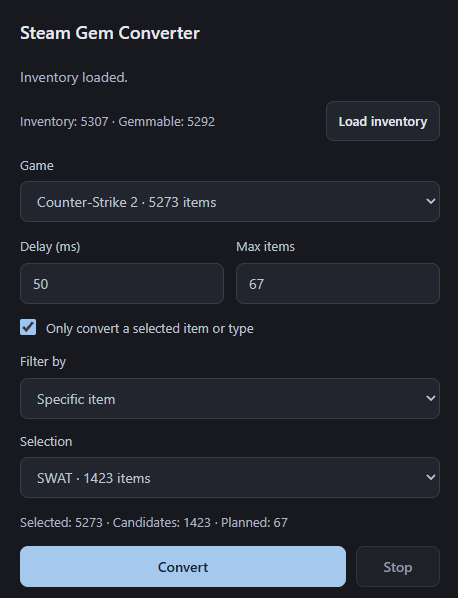

# Steam Gem Converter

A Chrome extension for converting selected Steam Community inventory items into gems.

## Features

- Load your full inventory and group gemmable items by game.
- Filter by a specific item or item type.
- Configure conversion delay and batch size; settings are saved locally.
- Follow progress and activity logs, or stop after the current item finishes.

## Install

1. In Chrome 111 or later, open `chrome://extensions` and enable **Developer mode**.
2. Click **Load unpacked** and select the folder containing `manifest.json`. No build is required.
3. Sign in to Steam Community and open your own inventory. Refresh the Steam tab after installing or reloading the extension. 

## Usage

1. Open the extension popup and click **Load inventory**.
2. Choose a **Game** and optionally enable the item/type filter.
3. Set **Delay (ms)** and **Max items**. Leave Max items blank for no limit.
4. Click **Convert**, review the confirmation summary, then confirm.
5. Monitor progress and logs. Click **Stop** to finish the current item without starting the next one.

Keep the Steam tab open. Reloading, navigating away from, or closing it ends the job; jobs do not resume automatically.
